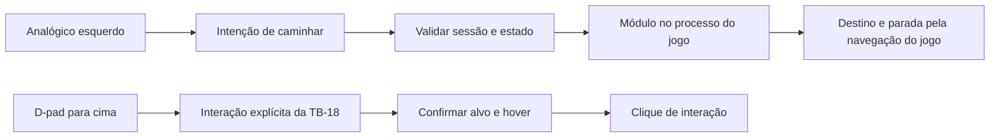

# Proposta: separar caminhada de interação no Torchlight 1

Estado em 10/11/2026: a implementação foi incorporada na branch feature/tb-18.
Este documento conserva a pesquisa e as alternativas consideradas. O contrato
atual, a instalação, as famílias cobertas e a validação estão em
[MOVIMENTO-SEGURO.md](MOVIMENTO-SEGURO.md). As seções abaixo são o estudo que
orientou a implementação, não instruções de configuração do aplicativo atual.

## Causa confirmada no projeto

Em `src/torchbridge/engine/core.py`, `_move_pointer()` posiciona o cursor ao
redor da âncora do personagem e retorna `auto_move=True`. `_process_active()`
combina `left_pressed = auto_move or a_pressed` e mantém o botão esquerdo
pressionado. O Torchlight decide entre andar, atacar, conversar e usar um
objeto conforme o alvo sob o cursor. Windows e Omarchy chegam à mesma regra;
trocar SendInput por outro transporte de mouse não separa essas ações.

A TB-18 acrescentou um caminho explícito em `engine/interaction.py`: **D-pad ↑**,
seleção por proximidade, projeção do alvo, confirmação de hover e um clique.
Ela ainda não removeu o clique gerado pela caminhada. O mapeamento de mercadores
e missões melhora a escolha e a indicação do alvo, mas não impede o caminho
antigo de acioná-lo.

Também precisam entrar na revisão:

- os pulsos de clique de `_auto_move_resume_times`, usados para retomar a
  caminhada depois de habilidades;
- A/Cruz, que deixa de segurar Shift quando o hover é interativo, e o binding
  de R3 para clique esquerdo: ainda permitem interação pelo cursor;
- o movimento com somente um painel lateral aberto, atualmente permitido;
- o cancelamento por foco, identidade do processo e controle em `InputSession`.

## Alternativas

| Abordagem | Resultado e limite | Decisão proposta |
| --- | --- | --- |
| Tecla nativa de movimento exclusivo, se existir nesta edição | Seria a integração mais simples; precisa funcionar sobre NPC, inimigo, loot e escada. | Verificar primeiro. Nenhum binding assim está confirmado no projeto; não assumir equivalência com Torchlight II/III. |
| Evitar entidades com o cursor e soltar o clique quando houver hover | Reduz acidentes, mas interrompe a caminhada e depende de projeção, hitboxes e leituras atrasadas. | Mitigação opcional; não atende à promessa de isolamento. |
| Clicar e limpar o alvo externamente na memória | A interação pode ocorrer antes da limpeza; um ponteiro zerado não desfaz diálogo ou troca de mapa e pode quebrar o estado interno. | Descartar. |
| Enviar destino à navegação nativa, sem clique de caminhada | Separa o comando de andar da seleção sob o mouse e preserva o caminho calculado pelo jogo. | Caminho recomendado para a prova de conceito. |

Não há proposta de escrever a posição do personagem: isso seria deslocamento
direto, poderia atravessar obstáculos e não preservaria a navegação original.

## Fluxo recomendado

O motor Python continua lendo o controle, aplicando deadzone e decidindo o
contexto. Um backend de movimento separado recebe a direção e o pedido de
parada. No backend nativo, o analógico não posiciona o mouse para andar nem
pressiona o botão esquerdo. A mira, os menus e a interação mantêm seus fluxos.

O módulo calcula um destino curto no plano X/Z do Ogre, orientado pela câmera.
As posições e matrizes já publicadas por `world_memory.py` dão contexto para
isso, mas o módulo deve revalidar jogador e cenário no momento de executar.
Direita na tela não pode ser tratada simplesmente como +X do mundo.

As ordens devem ser consumidas na **thread de atualização do jogo**, respeitando
colisões, pathfinding, morte, cutscenes, menus e habilidades que bloqueiam
movimento. Não chamar funções do jogo pela thread de rede nem por uma thread
remota criada para cada comando. O destino deve ter frequência limitada e
medida; os 120 Hz do controle não exigem 120 buscas de caminho por segundo.

Ao iniciar a caminhada, alvos antigos de ataque/interação precisam ser
cancelados pelas rotinas do próprio jogo, quando a transição permitir. Ao
soltar o analógico, enviar parada, sem deixar o personagem terminar um caminho
longo. Habilidades têm prioridade e a caminhada só retoma quando o estado do
jogo permitir, substituindo os pulsos de clique atuais.

Há uma ressalva importante: a rotina candidata de destino consulta o estado de
"manter posição" (Shift) e pode seguir um ramo de ataque. Não basta chamar
`setDestination` indiscriminadamente. O contrato do backend deve suspender a
caminhada durante esse estado e validar a coordenação com A e as habilidades.

## Evidências e o que ainda falta validar

Existem implementações públicas independentes que chamam a navegação do
Torchlight 1 sem passar pelo clique. São referências para a pesquisa, não
código incorporado ao TorchBridge:

| Rotina candidata | GOG, VA preferencial | Steam, VA preferencial |
| --- | --- | --- |
| `CCharacter::setDestination` / `MoveTo` | `0x00494B30` | `0x00492AD0` |
| `CCharacter::stopPathing` | `0x00486150` | `0x00484360` |
| `CCharacter::setTarget` | `0x004949D0` | `0x00492970` |
| `CCharacter::setTargetItem` | `0x00494AB0` | `0x00492A50` |

Os endereços vêm das referências abaixo. Nesta investigação, a desmontagem do
executável Steam local confirmou que a candidata de destino consulta os campos
de pathfinding, estado, habilidade e Shift; a candidata de parada limpa o
estado de caminho. **Isso não equivale a validar chamadas em execução** nem
confirma todos os executáveis GOG/Steam disponíveis.

O Steam inspecionado tem SHA-256
`a783a60725abd20ba0b5cd64f210f9b5baa08f07a0222a56c8f1e5e182b3eec6`.
Uma implementação deve identificar o executável, validar assinaturas e ABI x86
e resolver RVA pela base real, incluindo ASLR. Builds desconhecidas não devem
receber chamadas com endereços presumidos. A prova de conceito precisa confirmar
semântica de alvos, parada, combate e transições em ambas as distribuições.

### Escadas, portais e gatilhos de presença

Separar o clique evita acionar NPCs e objetos pela mira de caminhada. Porém,
o jogo também tem `CTriggerBox`, `CTriggerSphere` e `CWarper`, que participam de
eventos de presença e troca de cenário. Um destino de caminhada não impede,
por si só, que entrar num volume dispare um evento.

A escada testada na TB-18 foi reconhecida pelo hover de item e ativada por
clique. Isso não prova que todas as escadas, portais ou mapas usem esse fluxo.
Antes de prometer que só D-pad ↑ muda de andar, é necessário classificar cada
caso. Se existir transição por presença, a prova de conceito deve testar uma
autorização explícita, curta, vinculada à instância e ao cenário da transição.
O bloqueio teria de atuar apenas nesse tipo de transição do jogador local,
preservando missões, spawns, scripts e portais gerados por habilidades.
Se não for possível distinguir os eventos com segurança, esse caso permanece
um limite declarado, e não se bloqueiam todos os triggers globalmente.

## Windows e Omarchy

O jogo é PE32 nos dois ambientes: Windows nativo ou Proton/Wine no Omarchy.
Um pequeno módulo Windows x86 pode executar as mesmas rotinas nos dois; o
TorchBridge e seu overlay continuam nativos do sistema hospedeiro.

Essa é uma ampliação da arquitetura atual, cujo leitor é somente leitura.
Precisamos validar carga opcional do módulo e transporte local entre Python e
jogo. Um protótipo pode usar TCP de loopback com sessão identificada; não assumir
que o canal Windows de memória compartilhada do overlay está acessível pelo
Python Linux. O receptor apenas publica a intenção mais recente para consumo
pela thread do jogo, sem acumular uma fila de destinos antigos.

O protocolo deve incluir versão, identidade da sessão/processo, sequência e
prazo curto de validade. A perda de foco, desativação, desconexão, carregamento,
troca de personagem/cenário ou ausência de renovação cancela o movimento. O
módulo também precisa verificar foco e expiração, mesmo se o Python travar.
Relógios monotônicos de processos/ambientes diferentes não devem ser comparados
sem um protocolo definido; o receptor pode medir o tempo desde o recebimento.

O movimento não deve depender de `Present`, FPS de renderização ou da instalação
do overlay D3D9. A DLL atual de fullscreen é opcional e específica do renderer;
o transporte Wayland continua atendendo mouse/teclado e o overlay no Omarchy.
A instalação precisa detectar conflito com outros módulos, permitir remoção
e ser testada inicialmente em cópia/prefixo isolados.

Sugestão de rollout: backend nativo experimental e explicitamente selecionado,
com estado visível na calibração. Se indisponível, ele informa a falha e para;
não volta silenciosamente ao clique de caminhada. O modo legado continua uma
escolha explícita durante a validação.

## Sequência de implementação e aceite

1. Verificar uma possível ação nativa de movimento exclusivo e reproduzir o
   acidente em NPC, mercador, missão, inimigo, loot e escada. Se uma tecla resolver
   todos os casos, preferir a integração comum de entrada.
2. Na ausência dessa ação confirmada, provar `MoveTo` e `stopPathing` na thread
   do jogo, com direção relativa à câmera, sem enviar clique. Começar pelo Steam
   disponível e repetir no GOG; validar Windows e Proton.
3. Integrar o backend ao motor: retirar caminhada de `left_pressed`, substituir
   pulsos de retomada e arbitrar movimento, combate, interação e menus.
4. Manter D-pad ↑ para interação explícita. Se o objetivo incluir exclusividade
   total desse botão, também restringir os caminhos A/R3 no overworld; retirar
   somente o clique do analógico não muda esses bindings.
5. Classificar transições por presença e demonstrar o comportamento escolhido
   para elas, sem desativar eventos gerais do cenário.
6. Mostrar na calibração backend, direção, destino, último comando aceito e
   motivo de suspensão, mantendo os marcadores de entidades da TB-18.

O aceite exige caminhar e girar junto a mercadores, NPCs com missão, inimigos,
loot, portas, escadas e portais sem interação causada pelo analógico; D-pad ↑
deve continuar funcionando. Testar paredes, passagens estreitas, mudanças de
câmera, painel lateral, combate, soltar o stick, Alt+Tab, desligar o controle,
reiniciar o jogo e interromper o TorchBridge. Medir parada e custo de pathfinding.
São necessárias sessões reais em Windows/Omarchy, janela/fullscreen e builds
suportadas: testes simulados e CI não comprovam o comportamento do jogo.

## Fontes

- Código atual: `engine/core.py`, `engine/interaction.py`, `input_session.py`,
  `world.py`, `world_memory.py`, `native/fullscreen` e `native/linux`.
- [Posicionamento e interação já implementados](POSICIONAMENTO.md), incluindo
  o teste real da escada e o layout de memória usado pela TB-18.
- [Manual oficial do Torchlight distribuído pela Steam](https://cdn.akamai.steamstatic.com/steam/apps/41500/manuals/TorchlightManual.pdf):
  movimento e interação por apontar e clicar.
- [Pesquisa original de movimento no torchlight-xbox-ui-pc](https://github.com/YaPeL/torchlight-xbox-ui-pc/blob/3bd5c54023249f87564173c9da73be834e748beb/proxy/pad.c)
  e [correspondência de endereços Steam/GOG](https://github.com/YaPeL/torchlight-xbox-ui-pc/blob/3bd5c54023249f87564173c9da73be834e748beb/proxy/addresses_steam.txt).
  Referência GPL-3.0: usar fatos para validação e uma implementação própria,
  sem transplantar código para o projeto MIT.
- [Pesquisa original do TorchlightMultiplayer](https://github.com/mentalfoundry/TorchlightMultiplayer/blob/6d9b3bf1ca49f7638b99413cc65586347936c6ab/src/game/engine.h)
  e [notas sobre navegação e triggers](https://github.com/mentalfoundry/TorchlightMultiplayer/blob/6d9b3bf1ca49f7638b99413cc65586347936c6ab/re/NOTES.md).
