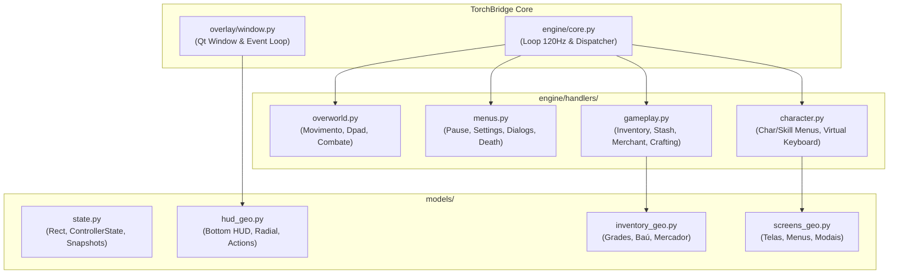
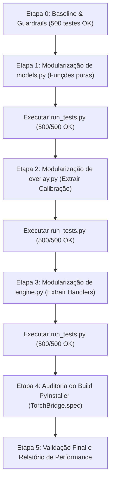

# Diretrizes de Boas Práticas e Arquitetura Modular — TorchBridge

> **Objetivo:** Estabelecer o plano de modularização e modernização do código Python do TorchBridge sem introduzir nenhuma alteração comportamental (zero breaking changes), preservando os 500 testes unitários e otimizando drasticamente a velocidade de busca, indexação e iteração da Inteligência Artificial no repositório.

---

## 1. Diagnóstico da Situação Atual

Após a limpeza de artefatos legados (TB-20), o projeto ficou com sua base de arquivos enxuta, mas a estrutura interna do código em `src/torchbridge/` ainda concentra um alto acoplamento em arquivos monolíticos:

| Arquivo | Linhas de Código | Responsabilidades Acumuladas | Impacto na IA e Dev |
| :--- | :---: | :--- | :--- |
| [`engine.py`](file:///c:/Users/kleve/Documents/Projetos/TorchBridge/src/torchbridge/engine.py) | **6.372** | Loop de 120Hz, injeção Win32, tradução analógica e **29 métodos de navegação de telas** (3.995 linhas só de handlers). | Arquivo gigante (~50k tokens). Qualquer ajuste simples de menu exige ler e regravar milhares de linhas, gerando lentidão e risco de regressão. |
| [`overlay.py`](file:///c:/Users/kleve/Documents/Projetos/TorchBridge/src/torchbridge/overlay.py) | **2.829** | Ciclo de vida da janela Qt, timers, interpolação de animações e um bloco de calibração visual com mais de **1.100 linhas em um único método**. | Dificulta manutenção de UI e gera conflito entre desenho do HUD operacional e desenho de debug. |
| [`models.py`](file:///c:/Users/kleve/Documents/Projetos/TorchBridge/src/torchbridge/models.py) | **2.467** | 4 classes de dados e **79 funções puras soltas** calculando rects de teclado, pet, menus, baú, loja, pesca e inventário. | Acúmulo de geometria heterogênea em um único arquivo de dados. |
| [`memory.py`](file:///c:/Users/kleve/Documents/Projetos/TorchBridge/src/torchbridge/memory.py) | **1.041** | Structs Win32, classes CEGUI, ponteiros GOG/Steam, offsets e leitor de memória de processos. | Boa coesão interna, porém extenso. |
| **Demais módulos** | 1.834 | `app.py` (360), `config.py` (396), `controller.py` (381), `win32.py` (468), etc. | Tamanho e escopo adequados (200 a 400 linhas). |

### Por que arquivos acima de 1.500 linhas prejudicam a IA?
1. **Consumo desnecessário de Context Window**: Carregar 6.300 linhas de código para alterar uma regra de 15 linhas no menu de pesca consome quase um terço do limite de contexto de modelos avançados.
2. **Latência de Leitura e Edição**: Ferramentas de diff e busca textual precisam varrer milhares de caracteres, aumentando o tempo de resposta das ferramentas.
3. **Perda de Foco do Modelo**: Arquivos com dezenas de responsabilidades aumentam a chance do modelo alucinar assinaturas ou quebrar funções adjacentes não relacionadas.

---

## 2. Princípios Arquiteturais e Padrões Alvo

O projeto adotará a transição do modelo monolítico para o **Padrão Modular Pythonico (Pacote como Módulo)**, equivalente à atomização e componentização do React.



### 2.1. Princípio da Responsabilidade Única (SRP)
Nenhum arquivo de código deverá ultrapassar **400 a 500 linhas**. Cada arquivo terá um escopo restrito e coeso:
- Arquivos de motor processam regras de fluxo e entrada.
- Arquivos de geometria (`geo`) realizam apenas matemática pura e mapeamento de coordenadas.
- Arquivos de interface (`renderers`) cuidam estritamente do desenho com `QPainter`.

### 2.2. Zero Breaking Changes (Garantia de Retrocompatibilidade)
A refatoração modular **não altera a API pública do pacote**. O padrão `__init__.py` será utilizado para reexportar todos os símbolos originais:

```python
# O código externo e os testes continuarão fazendo exatamente isso:
from torchbridge.engine import BridgeEngine
from torchbridge.models import Rect, OverlaySnapshot, inventory_slot_rect
from torchbridge.overlay import GameOverlay
```
Internamente, `src/torchbridge/engine/` passa a ser um diretório com seu próprio `__init__.py`, permitindo a transição transparente sem quebrar testes, imports nem o executável do PyInstaller.

---

## 3. Estrutura Modular Proposta

### 3.1. Reestruturação do `engine.py` (De 6.372 linhas para módulos de ~300 linhas)

```text
src/torchbridge/engine/
├── __init__.py               # Reexporta BridgeEngine (retrocompatível)
├── core.py                   # Thread do motor, loop de 120Hz, SendInput, desacoplamento
├── state.py                  # Estado do motor, flags de sincronização, debounce
├── dispatcher.py             # Mapeia o estado da memória para o handler correspondente
└── handlers/
    ├── __init__.py
    ├── base.py               # Protocol/Interface comum para handlers
    ├── overworld.py          # Movimento direto, mira analógica, remap de gatilhos e d-pad
    ├── radial.py             # Navegação da roda de atalhos e seleção de slots
    ├── common_menus.py       # Pause, telas de morte, configurações e diálogos de NPC
    ├── character_flow.py     # Criação de boneco, tela de load, seleção de dificuldade
    ├── virtual_keyboard.py   # Entrada no teclado virtual e navegação por grid
    ├── char_skill_menus.py   # Telas de atributos, skill trees e distribuição de pontos
    ├── inventory_flow.py     # Inventário do jogador, inventário do pet e baú (stash)
    ├── merchant_flow.py      # Telas de loja/vendedor
    └── crafting_flow.py      # Encantamento e transmutação
```

### 3.2. Reestruturação do `models.py` (De 2.467 linhas para módulos especializados)

```text
src/torchbridge/models/
├── __init__.py               # Reexporta Rect, ControllerState, Snapshots e funções de rects
├── base.py                   # Rect, ControllerState, OverlaySnapshot, SharedOverlayState
├── hud.py                    # Rects do HUD inferior, menu radial, botões roxos e pet actions
├── inventory.py              # Grade 4x3 de itens, slots do pet, baú e mercador
├── character.py              # Layouts das skill trees (Alchemist, Destroyer, Vanquisher)
├── keyboard.py               # Grid 5x13 do teclado virtual, posições de teclas e highlights
└── screens.py                # Rects de morte, pause, criação de personagem, diálogos e pesca
```

### 3.3. Reestruturação do `overlay.py` (De 2.829 linhas para componentes dedicados)

```text
src/torchbridge/overlay/
├── __init__.py               # Reexporta GameOverlay
├── window.py                 # QWidget principal, janelas transparentes, timers e hooks Win32
├── animator.py               # Easing functions, transições de fade e scale do radial
└── renderers/
    ├── __init__.py
    ├── bottom_hud.py         # Desenho das artes de controle (Xbox, PS, Switch)
    ├── radial_menu.py        # Desenho da roda de habilidades, ícones e tooltips
    ├── pet_submenu.py        # Submenu circular de ações do pet
    ├── virtual_keyboard.py   # Renderização do teclado virtual e highlights
    ├── shortcut_config.py    # Overlay de remapeamento e tela de ajuda
    └── calibration.py        # O bloco de 1.100 linhas de polígonos de calibração isolado
```

---

## 4. Padrões de Código e Convenções Pythônicas

Para manter o projeto em nível profissional de manutenção contínua, aplicaremos:

### 4.1. Tipagem Estrita e Recursos Modernos (Python 3.10+)
- **Unions limpos**: Substituir `Union[A, B]` e `Optional[A]` por `A | B` e `A | None`.
- **Coleções genéricas integradas**: Usar `list[str]`, `dict[str, int]`, `tuple[float, float]` em vez de importar de `typing`.
- **Classes de dados leves**:
  ```python
  from dataclasses import dataclass

  @dataclass(slots=True, frozen=True)
  class ClickTarget:
      x: int
      y: int
      description: str = ""
  ```
  O uso de `slots=True` reduz o consumo de memória e melhora a velocidade de acesso aos atributos.

### 4.2. Injeção de Dependência via `Protocol` (Duck Typing Estático)
Em vez de handlers acessarem o `BridgeEngine` completo com acoplamento circular, definimos protocolos enxutos:
```python
from typing import Protocol
from torchbridge.models import ControllerState

class InputBridge(Protocol):
    def send_key(self, scancode: int, down: bool) -> None: ...
    def send_mouse_click(self, x: int, y: int, button: str) -> None: ...

class ScreenNavigationHandler(Protocol):
    def handle_input(self, state: ControllerState, bridge: InputBridge) -> bool: ...
```

### 4.3. Tratamento Específico de Erros (EAFP)
- Nunca usar `except Exception: pass`.
- Capturar especificamente as exceções mapeadas (`OSError`, `ValueError`, `KeyError`).

### 4.4. Padronização com Ruff
Configuração sugerida para o [`pyproject.toml`](file:///c:/Users/kleve/Documents/Projetos/TorchBridge/pyproject.toml):
```toml
[tool.ruff]
line-length = 120
target-version = "py311"

[tool.ruff.lint]
select = [
    "E",   # Erros PEP 8
    "W",   # Avisos PEP 8
    "F",   # Pyflakes (variáveis não usadas, imports soltos)
    "I",   # isort (organização de imports)
    "B",   # flake8-bugbear (armadilhas comuns)
    "UP",  # pyupgrade (sintaxe moderna automática)
]
ignore = ["E501"] # Linhas longas em docstrings/comentários matemáticos mantidas
```

---

## 5. Roteiro de Execução Passo a Passo (Plano Seguro)

A transição será executada de forma estritamente incremental, garantindo que a suíte de testes nunca fique quebrada em nenhuma etapa:



### Fase 1: Modularização do `models.py` (Baixo Risco)
- **Motivo**: `models.py` contém majoritariamente funções matemáticas e dicionários puros, sem threads ou chamadas de sistema.
- **Ação**:
  1. Transformar `models.py` em pacote `models/`.
  2. Extrair funções por contexto (`hud.py`, `inventory.py`, `character.py`, `screens.py`).
  3. No `models/__init__.py`, reexportar tudo com `__all__`.
  4. Executar `python scripts/run_tests.py` para validar 100% dos testes.

### Fase 2: Modularização do `overlay.py` (Médio Risco)
- **Motivo**: Isolar o método `_draw_calibration` (1.106 linhas) que polui a lógica do overlay.
- **Ação**:
  1. Transformar `overlay.py` em pacote `overlay/`.
  2. Extrair renderizadores secundários para `renderers/`.
  3. Manter a classe `GameOverlay` em `window.py` com apenas 300–400 linhas orquestrando os componentes.
  4. Executar os testes de overlay e ciclo de vida.

### Fase 3: Modularização do `engine.py` (Médio/Alto Risco)
- **Motivo**: O núcleo de 6.372 linhas.
- **Ação**:
  1. Criar a pasta `engine/handlers/`.
  2. Migrar os métodos `_handle_*` em grupos lógicos (ex: primeiro telas simples como `death_screen`, `pause`, depois `inventory` e `skills`).
  3. No `engine/core.py`, manter o loop de 120Hz e a máquina de despacho delegando para cada handler.
  4. No `engine/__init__.py`, reexportar a classe `BridgeEngine`.
  5. Testar iterativamente a cada grupo extraído.

### Fase 4: Validação de Build e Empacotamento
- Validar se o PyInstaller empacota normalmente via [`TorchBridge.spec`](file:///c:/Users/kleve/Documents/Projetos/TorchBridge/TorchBridge.spec).
- Confirmar que não há caminhos relativos de assets quebrados.

---

## 6. Checklist de Qualidade para Cada Iteração

- [ ] **Testes Automatizados**: Todos os 500 testes em [`scripts/run_tests.py`](file:///c:/Users/kleve/Documents/Projetos/TorchBridge/scripts/run_tests.py) executam e passam (`OK`).
- [ ] **Zero Imports Circulares**: Estrutura em árvore estrita sem dependências cruzadas entre pacotes.
- [ ] **Compatibilidade de Assinaturas**: Nenhuma assinatura de método público foi alterada.
- [ ] **Tamanho Máximo por Arquivo**: Nenhum arquivo novo excede 400 linhas.
- [ ] **Indexação Ágil**: A busca de símbolos pela IA localiza o domínio imediatamente na pasta correspondente.

